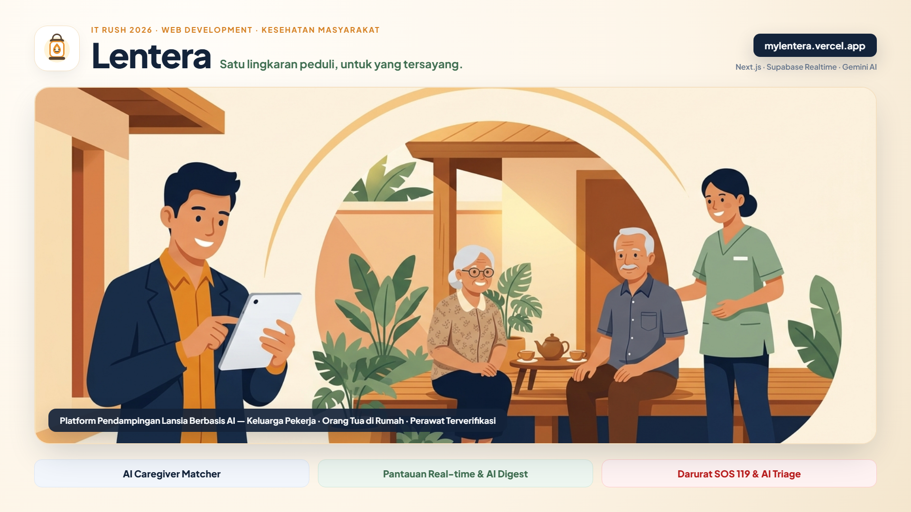

# Lentera

**Satu lingkaran peduli, untuk yang tersayang.**

**Lentera** adalah platform web pendampingan lansia berbasis Artificial Intelligence (AI) yang menjembatani **keluarga pekerja**, **perawat lansia terverifikasi**, dan **kebutuhan harian orang tua di rumah** dalam satu ekosistem pemantauan kesehatan real-time dan respon darurat SOS 119.

Dikembangkan untuk **IT RUSH 2026 — Web Development (HIMATIF Universitas Bengkulu)** pada subtema **Kesehatan Masyarakat**, sekaligus mendorong akses kerja yang lebih aman dan layak bagi perawat lansia di Indonesia.

- **Aplikasi Live:** [https://mylentera.vercel.app](https://mylentera.vercel.app)
- **Video Demo (YouTube):** [https://youtu.be/tq-0hm2WYxo](https://youtu.be/tq-0hm2WYxo)

---

## Latar Belakang & Realitas Indonesia

Bagi jutaan pekerja di Indonesia, rasa cemas terhadap kondisi orang tua yang tinggal di rumah terjadi setiap hari: apakah obat rutin sudah diminum, apakah porsi makan siang habis, dan apakah beliau aman saat beraktivitas sendiri.

| Indikator | Data | Sumber |
| :--- | :---: | :--- |
| Pekerja produktif Indonesia yang merupakan generasi sandwich | **49%** | BPS 2024 / Jakpat |
| Lansia yang dirawat keluarga sendiri tanpa pelatihan medis | **80,8%** | Survei Kesehatan Indonesia (SKI 2023), Kemenkes RI |
| Lansia yang didampingi caregiver terlatih di rumah | **1,3%** | SKI 2023 / Databoks |
| Risiko kejadian jatuh pada lansia usia 75 tahun ke atas | **76,2%** | Riskesdas, Kemenkes RI |

Di sisi lain, banyak perawat lansia terlatih justru kesulitan menemukan keluarga yang membutuhkan pendampingan secara aman, jelas, dan transparan. Lentera hadir untuk menjembatani kedua sisi tersebut.

---

## Ekosistem Terpadu Lentera

Dengan satu ekosistem yang saling tersinkronisasi:

- **Keluarga Pekerja** dapat bekerja dengan tenang melalui pantauan tanda vital harian secara real-time, ringkasan harian berbasis AI, dan peringatan darurat instan.
- **Orang Tua di Rumah** tetap nyaman berada di lingkungan rumah sendiri dengan pendampingan rutin, kepatuhan obat, dan kesiapsiagaan medis.
- **Perawat Terverifikasi** memperoleh akses lowongan dan undangan kerja secara langsung, aman, dan transparan dari keluarga.

---

## Fitur Utama

### 1. Rekrutmen Dua Arah & AI Caregiver Matcher
- Keluarga dapat memilih perawat yang sedang tersedia di direktori untuk mengirim **undangan wawancara secara real-time**, atau memasang **lowongan perawatan** sesuai jadwal dan kondisi medis orang tua.
- Perawat langsung menerima undangan maupun lowongan tersebut di **Ruang Perawat**, merespons undangan, dan mengirimkan lamaran.
- **AI Caregiver Matcher** bertenaga Google Gemini secara otomatis menghitung skor kecocokan (%) keahlian pelamar terhadap kebutuhan medis orang tua beserta alasan klinisnya.
- Begitu perawat resmi direkrut, seluruh ruang pemantauan (*Kondisi Orang Tua*, *Laporan Masuk*, *Catat Harian*, dan *Darurat SOS*) otomatis terbuka di kedua sisi.

### 2. Pemantauan Harian Real-Time
- Setiap hari, perawat mencatat tanda vital meliputi **tekanan darah**, **detak nadi**, **porsi makan**, **kepatuhan obat**, **suasana hati**, catatan tambahan, hingga **foto aktivitas** dalam hitungan detik.
- Laporan langsung tersinkronisasi ke **Dashboard Keluarga** melalui Supabase Realtime, lengkap dengan **grafik perkembangan kesehatan** dan notifikasi perangkat.

### 3. AI Daily Digest & Deteksi Dini
- Alih-alih hanya menampilkan angka mentah, **AI Daily Digest** merangkum seluruh catatan harian menjadi laporan berbahasa manusia yang mudah dipahami keluarga.
- Sistem membantu mendeteksi potensi anomali kesehatan lebih dini serta menyusun rekomendasi menu makanan, hidrasi, dan aktivitas ringan yang sesuai untuk orang tua.

### 4. Respon Darurat SOS 119 & AI Triage Brief
- Ketika kondisi mendesak terjadi (seperti lonjakan tekanan darah atau kejadian jatuh), perawat memicu tombol **Darurat SOS** yang dilengkapi dialog konfirmasi keamanan untuk mencegah kesalahan tekan.
- Keluarga langsung menerima peringatan darurat di seluruh halaman aplikasi beserta tombol aksi cepat ke layanan **119** dan **WhatsApp Perawat**.
- Di saat bersamaan, **AI Triage Brief** menyusun kartu ringkasan medis instan berisi riwayat pasien, alergi, obat rutin, tanda vital terakhir, dan langkah pertolongan pertama yang siap ditunjukkan kepada tim ambulans.

---

## Video Demo

Tonton demonstrasi lengkap alur aplikasi Lentera melalui tautan berikut:

[](https://youtu.be/tq-0hm2WYxo)

Link langsung: [https://youtu.be/tq-0hm2WYxo](https://youtu.be/tq-0hm2WYxo)

---

## Cara Mencoba Aplikasi

Aplikasi dapat langsung diuji pada [https://mylentera.vercel.app](https://mylentera.vercel.app) tanpa setup tambahan:

1. Buka halaman `/register` dan buat akun **Keluarga** (langsung aktif masuk ke Ruang Keluarga).
2. Buka tab browser kedua, buka `/register` dan buat akun **Perawat** (sesi autentikasi terisolasi per tab via `sessionStorage`, sehingga peran Keluarga dan Perawat dapat diuji berdampingan dalam satu browser).
3. Dari tab **Keluarga**, kirim undangan wawancara atau pasang lowongan, lihat skor **AI Caregiver Matcher**, lalu tugaskan perawat.
4. Dari tab **Perawat**, menu **Catat Harian** dan **Darurat SOS** akan terbuka otomatis. Kirim catatan vital harian atau uji tombol **Darurat SOS** untuk melihat sinkronisasi real-time dan output AI di tab **Keluarga**.

---

## Tech Stack

- **Frontend & API Routes:** Next.js 16 (App Router), React 19, TypeScript
- **Styling & Visualisasi:** Tailwind CSS v4, Lucide React, Recharts, GSAP
- **Backend, Auth, Realtime & Storage:** Supabase (PostgreSQL + RLS, Auth, Realtime, Storage)
- **AI Engine:** Google Gemini API (`gemini-2.5-flash`)

---

## Menjalankan Secara Lokal

### Prasyarat
- Node.js 20+
- Proyek Supabase (jalankan skema SQL pada `supabase/schema.sql`)
- Google Gemini API Key

### Langkah Instalasi

```bash
npm install
cp .env.example .env.local
```

Isi variabel lingkungan pada `.env.local`:

```env
NEXT_PUBLIC_SUPABASE_URL=https://your-project-ref.supabase.co
NEXT_PUBLIC_SUPABASE_ANON_KEY=your-supabase-anon-key
GEMINI_API_KEY=your-gemini-api-key
GEMINI_MODEL=gemini-2.5-flash
```

Jalankan server pengembangan:

```bash
npm run dev
```

Aplikasi berjalan pada `http://localhost:3000`.

---

## Transparansi Library & Penggunaan AI

- **Library Open-Source:** `next`, `react`, `react-dom`, `tailwindcss`, `@supabase/supabase-js`, `@google/genai`, `lucide-react`, `recharts`, `gsap`.
- **Pemanfaatan AI:** Dalam pengembangan proyek ini, AI coding assistant digunakan secara transparan untuk membantu scaffolding komponen antarmuka, refactoring TypeScript, audit bug, serta generasi aset ilustrasi editorial. Seluruh arsitektur sistem, integrasi database, alur pengguna, dan verifikasi akhir dikendalikan dan divalidasi oleh tim pengembang.
